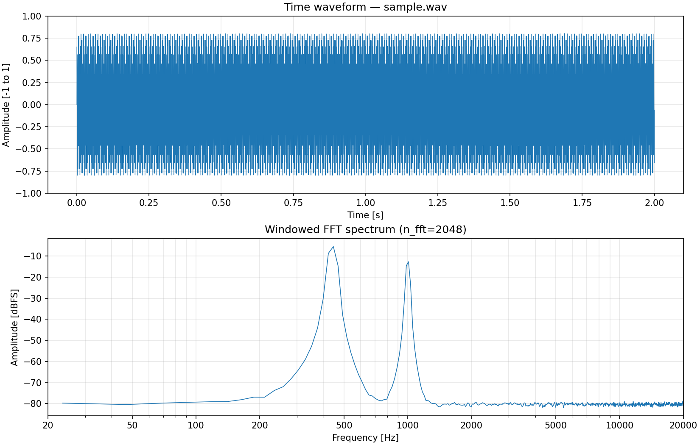
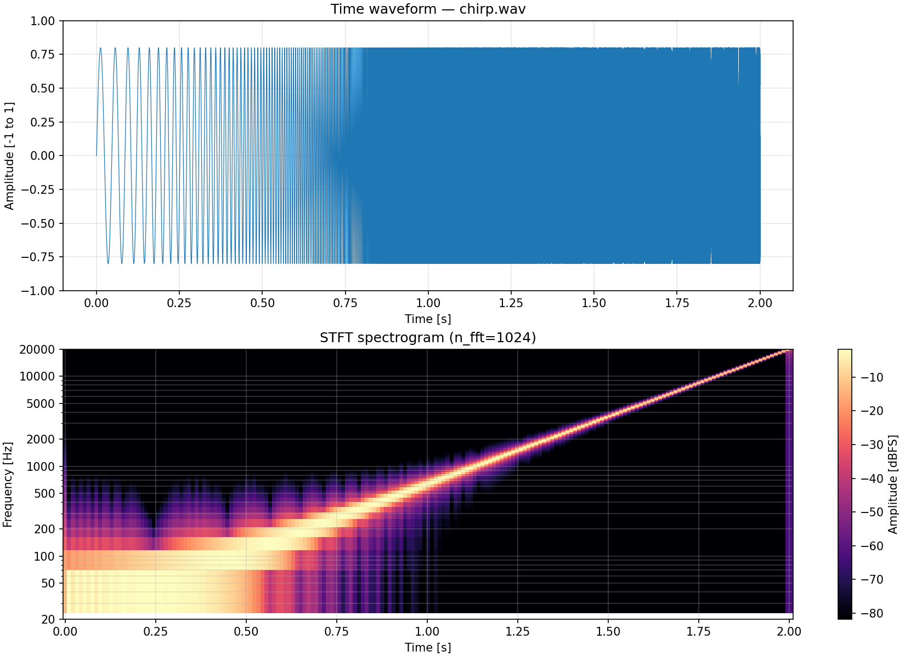

# audio-spectrum-cli

WAVファイルを読み込み、時間波形とFFT周波数スペクトルまたはSTFTスペクトログラムを1枚のPNGに描画するPython CLIです。モノラル・マルチチャンネルのPCM/float WAVに対応し、マルチチャンネル音声は解析前にモノラルへミックスします。

## セットアップ

Python 3.11以降を用意し、依存ライブラリをインストールします。

```bash
python -m pip install -r requirements.txt
```

## テスト音源の生成

440 Hzと1000 Hzのサイン波に微弱なホワイトノイズを加えた、48 kHz・16-bit・2秒のWAVを生成します。乱数シードを固定しているため、生成結果を再現できます。

```bash
python generate_test_wav.py
```

出力先を変える場合:

```bash
python generate_test_wav.py --output sample.wav
```

対数スイープ（20 Hzから20 kHzへ2秒で上昇するチャープ）を作る場合:

```bash
python generate_test_wav.py --type chirp --output chirp.wav
```

## 解析

従来の静止スペクトルは、`--mode spectrum`（既定値）で出力します。

```bash
python analyze.py sample.wav --mode spectrum --output result.png --n-fft 2048
```

時間とともに変化する周波数成分を調べるには、スペクトログラムを使います。

```bash
python analyze.py chirp.wav --mode spectrogram --output spec.png --n-fft 1024
```

- どちらのモードも上段は時間 [s] と振幅 [-1, 1] です。
- `spectrum` の下段は20 Hz〜20 kHzの対数周波数軸と振幅 [dBFS] です。FFT前にHann窓を適用し、50%オーバーラップのフレームの振幅スペクトルを平均します。
- `--n-fft` は窓長とFFTサイズです。大きくすると周波数分解能が上がり、時間方向の平均回数は少なくなります。
- `--mode spectrogram` では上段に時間波形、下段にSTFTスペクトログラムを描画します。周波数軸は既定で対数、`--frequency-scale linear` で線形に変更できます。
- `--db-range 80` はスペクトログラムのカラーマップをピークから80 dB下までに固定します。
- 入力ファイルが見つからない場合や、不正なWAVの場合はエラー内容を表示して終了します。

## 出力例

下図は同梱の `sample.wav` を `--n-fft 2048` で解析した画像です。



対数チャープをスペクトログラムで表示すると、20 Hzから20 kHzへ上昇する軌跡を確認できます。



