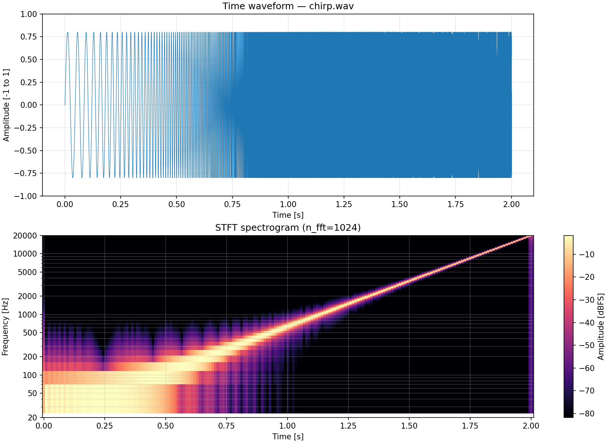

# PythonでWAVのFFTスペクトルとチャープのスペクトログラムを描く

WAVファイルをFFTで分析すると、どの周波数成分が含まれるか分かります。しかし、周波数が時間とともに移動する音では、ファイル全体のFFTだけでは「いつその周波数が現れたか」を読み取れません。この記事では、静止スペクトルと短時間フーリエ変換（STFT）によるスペクトログラムを作り、20 Hzから20 kHzへ上昇する対数チャープで比較します。

## 使い方

依存ライブラリをインストールし、テスト音源を作ります。

```bash
python -m pip install -r requirements.txt
python generate_test_wav.py
```

生成されるのは、48 kHz・16-bit・2秒のモノラルWAVです。440 Hzと1000 Hzのサイン波に、乱数シードを固定した小さなホワイトノイズを加えています。

```bash
python analyze.py sample.wav --mode spectrum --output result.png --n-fft 2048
```

チャープ信号を生成して、その時間変化をスペクトログラムで確認します。

```bash
python generate_test_wav.py --type chirp --output chirp.wav
python analyze.py chirp.wav --mode spectrogram --output spec.png --n-fft 1024 --db-range 80
```

`--mode spectrum` は従来の静止スペクトル、`--mode spectrogram` は時間ごとの周波数分布を表示します。スペクトログラムの周波数軸は既定で対数ですが、`--frequency-scale linear` で線形にできます。たとえば線形軸で描く場合は次のように指定します。

```bash
python analyze.py chirp.wav --mode spectrogram --frequency-scale linear --output spec-linear.png --n-fft 1024
```

`--db-range 80` は、信号のピークを上限（最大0 dBFS）に、そこから80 dB下までをカラーマップに表示します。表示幅を固定することで、微小なノイズに埋もれず主成分を確認できます。

## 時間波形と振幅の正規化

PCM整数値は、符号付き整数の最大絶対値で割って浮動小数点へ変換します。そのため、一般的なPCM音声をおよそ -1 から 1 の振幅として描画できます。ステレオなど複数チャンネルの音声は、チャンネル平均を取ってモノラル化します。

上段ではサンプル番号をサンプルレートで割り、時間軸を秒に変換しています。

## 定常信号のFFTスペクトル

440 Hzと1000 Hzのように、解析区間で周波数特性がほぼ変わらない信号は定常信号として扱えます。信号全体をFFTすれば周波数成分を高い周波数分解能で確認できます。

```python
window = np.hanning(n_fft)
magnitude = np.abs(np.fft.rfft(frame * window)) / window.sum()
```

有限長の信号をそのまま切り出すと端点の不連続によるスペクトル漏れが生じるため、Hann窓を適用します。窓の総和で振幅スケーリングを補正し、片側スペクトルをdBFSに変換します。信号全体をまとめるため、どの時点で周波数成分が変わったかは残りません。

## 非定常信号のSTFTスペクトログラム

チャープは時間とともに周波数が変化する非定常信号です。全体FFTではチャープに含まれる周波数は分かっても、周波数の上昇を時間軸上の軌跡として見ることはできません。そこで信号を短い窓に分け、各窓でFFTを行うSTFTを使います。各列のFFTを時間方向に並べ、色を振幅[dBFS]にするとスペクトログラムになります。



この図では対数周波数軸上を斜めに上がる成分が見えます。チャープ信号は次の式で生成できます。`T` は長さ、`f0` と `f1` は開始・終了周波数です。

```text
phase(t) = 2π f0 T / ln(f1/f0) * (exp(t ln(f1/f0) / T) - 1)
x(t) = 0.8 sin(phase(t))
```

瞬時周波数は `f0 * exp(t ln(f1/f0) / T)` となり、周波数が対数的に一定の割合で上昇します。

## 時間分解能と周波数分解能

STFTでは、窓を短くすると変化した時刻を細かく捉えられる一方、各FFTの周波数分解能は粗くなります。窓を長くすると近接した周波数を分けやすい代わりに、時間上の変化が平均化されます。これは時間と周波数を同時に任意の精度で決められないという不確定性の関係です。

`--n-fft` は窓長とFFTサイズを指定します。サンプルレートが48 kHzのとき1024サンプルは約21 msです。チャープの軌跡を滑らかに追うには短め、近い周波数成分を区別するには長めを選び、目的に応じて時間分解能と周波数分解能のバランスを取ります。

## 出力

スペクトルモードでは上段に時間波形、下段に20 Hzから20 kHzまでの対数周波数軸を使ったスペクトルを表示します。テスト音源では、およそ440 Hzと1000 Hzの成分がピークとして確認できます。スペクトログラムモードでは、同じ波形の上段と、時間を横軸・周波数を縦軸にしたSTFTの下段を表示します。

## 再現性とエラー処理

`requirements.txt` でNumPy、SciPy、Matplotlibのバージョンを固定し、テスト音源の乱数シードも固定しています。これにより、依存ライブラリと入力を揃えたときに同じ解析を再現できます。

WAVの読み込みエラーや出力画像の書き込みエラーは、ファイル名を含むメッセージとして表示します。マルチチャンネルのPCM/float WAVを扱えますが、再生目的のフォーマット変換や高度なチャンネル配置の保持は行わず、平均ミックスした音声を解析します。

## まとめ

短いスクリプトでも、窓関数、振幅スケーリング、対数周波数表示を意識することで、音声の時間・周波数の両方を確認できる図を作れます。実装とテスト音源はリポジトリに置いてあるので、別のWAVを渡して試すこともできます。
